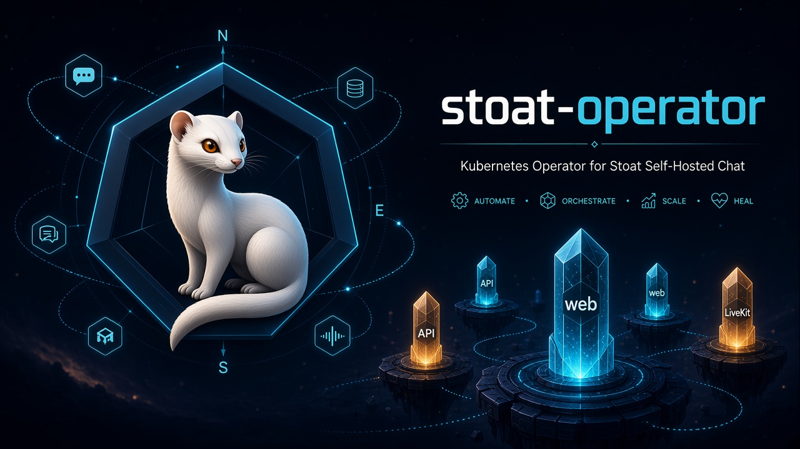

# Stoat Operator



Kubernetes operator for [Stoat](https://stoat.chat) self-hosted instances, modeled on the upstream [stoatchat/self-hosted](https://github.com/stoatchat/self-hosted) Docker Compose stack.

Declare a `Stoat` custom resource; the operator reconciles secrets/config, optional embedded dependencies (MongoDB, Valkey, RabbitMQ, MinIO/Silo), Stoat app services, an in-cluster Caddy edge, Ingress, and LiveKit (hostNetwork for RTC).

**Operator image:** `harbor.dataknife.net/library/stoat-operator`

## Architecture

```
Clients → Ingress (TLS) → Caddy
              ↓
   /api /ws /autumn /january /gifbox /livekit /ingress → app Services
              ↓
   MongoDB · Valkey · RabbitMQ · S3/Silo

Voice RTC → LiveKit hostNetwork (7881/tcp + 50000–50100/udp on the node)
```

Compose-compatible Service names (`database`, `api`, `redis`, …) are used so Stoat defaults resolve. **One `Stoat` CR per namespace** is recommended.

## CRD

| | |
|--|--|
| API group | `stoat.dataknife.ai` |
| Kind | `Stoat` (shortName `st`) |
| Version | `v1alpha1` |

Notable spec fields: `domain`, `version`, `generateSecrets` / `secretsRef`, `dependencies` (embed vs external), `ingress`, `livekit`, `storage`.

### Object storage

Two options:

1. **Embedded MinIO/Silo** (default) — omit `dependencies.objectStorage`; the operator
   deploys MinIO and creates bucket `revolt-uploads` (path-style S3).
2. **External S3** (e.g. RustFS) — set `dependencies.objectStorage` with `endpoint`,
   `credentialsSecret` (keys `accessKeyId` / `secretAccessKey`), and optional
   `bucket` / `region` / `pathStyleBuckets`. See `config/samples/stoat_rustfs.yaml`.

## Quick start

```shell
kubectl create namespace stoat
kubectl apply -k config/default
kubectl apply -f config/samples/stoat_v1alpha1_stoat.yaml
kubectl get stoat -n stoat
kubectl get deploy,svc,ingress -n stoat
```

Point DNS for `spec.domain` at your Ingress. Set `spec.ingress.tlsSecretName` (or Ingress annotations) for HTTPS.

Site-local (LAN/VPN) is the default (`livekit.useExternalIP: false`). That means
clients on your local network — not the Kubernetes pod network — reach LiveKit
via hostNetwork on the node LAN IP (or a kube-vip). Set `livekit.address` plus
`livekit.serviceType: LoadBalancer` for a stable VIP covering `7881/tcp` and the
UDP media range. Signaling still goes through Ingress/Caddy on your domain.

## Secrets

With `generateSecrets: true` (default), the operator creates Secret `stoat-secrets` once and **does not rotate** keys. Losing `REVOLT__FILES__ENCRYPTION_KEY` permanently locks stored files — back up the Secret.

Bring-your-own: set `secretsRef` to an existing Secret with the upstream `secrets.env` keys.

## Development

```shell
make generate manifests
make test
make build
```

Requires Go 1.25+, `controller-gen`, and optionally `golangci-lint`.

## Status

| Area | State |
|------|--------|
| Project scaffold (kubebuilder v4) | Done |
| `Stoat` CRD + sample | Done |
| Secret generation (VAPID, files, LiveKit) | Done |
| Revolt.toml / livekit.yml / Caddy / web env | Done |
| Embedded Mongo / Valkey / Rabbit / MinIO + bucket Job | Done |
| App Deployments + Services | Done |
| Caddy edge + Ingress | Done |
| LiveKit (hostNetwork RTC) | Done |
| External dependency refs (partial URI wiring) | Partial |
| Upgrades from self-hosted notices | Planned |
| Horizontal scaling / HA deps | Planned |

## References

- https://github.com/stoatchat/self-hosted
- https://developers.stoat.chat/
- https://github.com/DataKnifeAI/windrose-operator
- https://github.com/DataKnifeAI/palworld-operator
