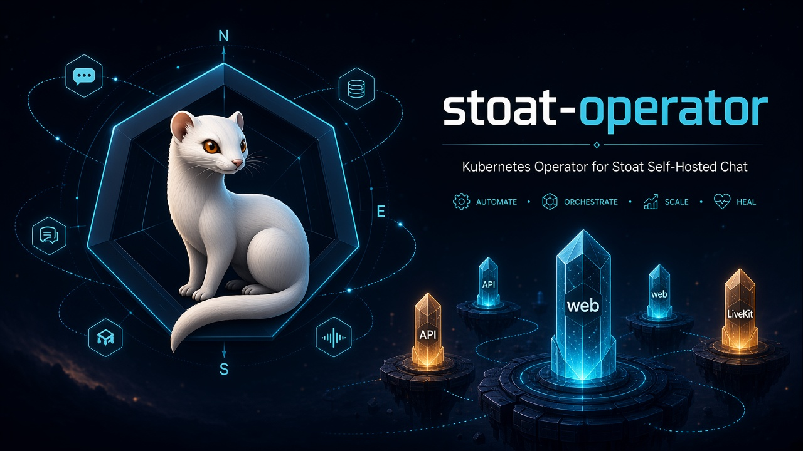

# Stoat Operator



Kubernetes operator for [Stoat](https://stoat.chat) self-hosted instances, modeled on the upstream [stoatchat/self-hosted](https://github.com/stoatchat/self-hosted) Docker Compose stack.

You declare a `Stoat` custom resource; the operator will eventually reconcile dependencies (MongoDB, Valkey, RabbitMQ, object storage), Stoat app services, HTTP ingress, and LiveKit voice exposure.

This scaffold matches the DataKnifeAI kubebuilder layout used by [windrose-operator](https://github.com/DataKnifeAI/windrose-operator) and [palworld-operator](https://github.com/DataKnifeAI/palworld-operator). **Component reconciliation is not implemented yet** — the controller validates the CR, manages a finalizer, and reports `Pending` status.

**Operator image:** `harbor.dataknife.net/library/stoat-operator`

## Architecture (target)

```
Clients → HTTPS (Ingress / Gateway API HTTPRoute)
              ↓
      web + api + events + autumn + january + …
              ↓
   MongoDB · Valkey · RabbitMQ · S3/Silo

Voice → LiveKit LoadBalancer / NodePort
         (7881/tcp + 50000–50100/udp)
```

Unlike the game-server operators (single pod + Envoy VIP), Stoat is an **umbrella stack CR**: many Deployments plus optional embedded or external dependencies, with LiveKit on a separate network path.

## CRD

| | |
|--|--|
| API group | `stoat.dataknife.ai` |
| Kind | `Stoat` (shortName `st`) |
| Version | `v1alpha1` |

Notable spec fields: `domain`, `version`, `generateSecrets` / `secretsRef`, `dependencies` (embed vs external), `ingress`, `livekit`, `storage`.

## Quick start

```shell
kubectl apply -k config/default
kubectl apply -f config/samples/stoat_v1alpha1_stoat.yaml
kubectl get stoat -A
```

## Development

```shell
make generate manifests
make test
make build
```

Requires Go 1.25+, `controller-gen`, and optionally `golangci-lint`.

## Status

| Area | State |
|------|--------|
| Project scaffold (kubebuilder v4) | Done |
| `Stoat` CRD + sample | Done |
| Finalizer + status conditions | Done |
| Secret / config generation | Planned |
| Embedded dependencies | Planned |
| App Deployments + Services | Planned |
| HTTP Ingress / Gateway | Planned |
| LiveKit exposure | Planned |
| Upgrades from self-hosted notices | Planned |

## References

- https://github.com/stoatchat/self-hosted
- https://developers.stoat.chat/
- https://github.com/DataKnifeAI/windrose-operator
- https://github.com/DataKnifeAI/palworld-operator
